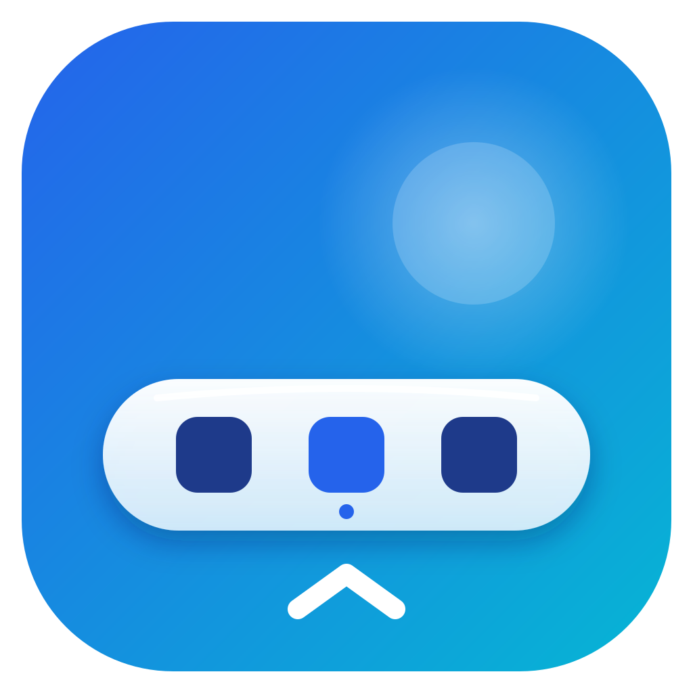
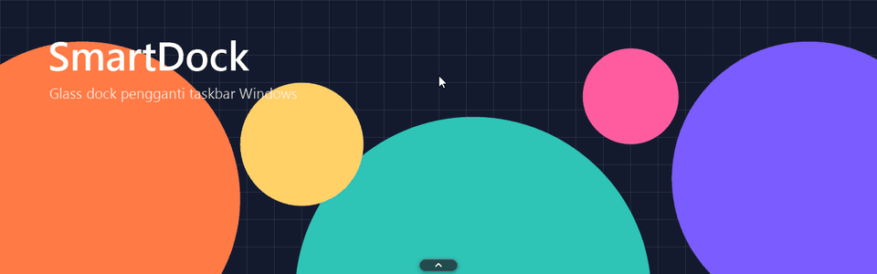

  

<h1 align="center">Vitrebar</h1>

  Dock kaca pengganti taskbar untuk Windows 10/11. 
  <a href="https://github.com/widwickyy/Vitrebar/releases/latest"><b>Unduh versi terbaru</b></a>

Vitrebar adalah pil kaca yang mengambang di tepi layar: berisi aplikasi, pemakaian CPU/RAM, suhu
komponen, volume, dan jam. Taskbar Windows disembunyikan selama Vitrebar berjalan dan dikembalikan
persis seperti semula saat keluar.

## Instalasi

1. Unduh `Vitrebar_<versi>_x64-setup.exe` dari [halaman Releases](https://github.com/widwickyy/Vitrebar/releases/latest).
2. Jalankan installer. Tidak perlu hak admin; Vitrebar terpasang untuk user Anda saja.

Catatan:

- Installer belum bertanda tangan digital, jadi Windows SmartScreen akan memperingatkan: pilih
  **More info → Run anyway**.
- Butuh Windows 10/11 64-bit (x64). WebView2 sudah ada di Windows 11 dan kebanyakan Windows 10;
  kalau belum, installer mengunduhnya.
- **Pengguna SmartDock:** Vitrebar dulu bernama SmartDock (sampai v0.2.0). Installer Vitrebar
  menutup dan meng-uninstall SmartDock lama, memindahkan pengaturan "jalan saat Windows mulai", dan
  memakai pin serta pengaturan yang sama.

Vitrebar memperbarui dirinya sendiri: sepuluh detik setelah dibuka ia memeriksa rilis terbaru di
sini, bertanya dulu, lalu mengunduh, memasang, dan memulai ulang. Pembaruan ditandatangani dan
diverifikasi sebelum dipasang. Bisa juga dicek manual: klik kanan dock → **Periksa pembaruan**.

## Fitur

### Dock

- **Pengganti taskbar.** Taskbar Windows disembunyikan (auto-hide atau sembunyi total) dan
  dikembalikan saat keluar, termasuk kalau Vitrebar crash atau dimatikan paksa.
- **Layar penuh untuk aplikasi.** Dock tidak memakan ruang layar; jendela yang di-maximize memakai
  seluruh layar dan dock mengambang di atasnya.
- **Efek kaca langsung.** Isi layar di belakang dock diburamkan dan dibengkokkan di tepi pil seperti
  lensa, mengikuti wallpaper (termasuk wallpaper animasi) dan jendela di belakangnya.
- **Posisi dan monitor.** Tepi bawah, atas, kiri, atau kanan layar. Tampil di monitor utama saja,
  mengikuti monitor tempat mouse berada, atau di setiap monitor.
- **Sembunyi otomatis.** Dock menyingkir 1,5 detik setelah mouse pergi dan menyisakan tab panah
  kecil; arahkan mouse ke tab untuk memunculkannya. Dock juga hilang saat ada aplikasi fullscreen
  (video, game, browser F11).
- **Perbesar ikon.** Opsional: ikon di dekat kursor membesar seperti di dock macOS (1,2 sampai 2×).

### Aplikasi

- **Aplikasi yang di-pin dan jendela terbuka**, dikelompokkan per aplikasi dengan ikon aslinya.
  Klik untuk membuka, fokus, atau minimize; klik berulang berpindah antarjendela; klik tengah
  membuka jendela baru.
- **Menu klik kanan:** Buka jendela baru, Tutup jendela, Akhiri tugas, Sematkan/Lepas dari dock.
- **Atur dengan seret.** Seret ikon untuk mengubah urutan. Seret `.exe`, `.lnk`, `.url`, atau folder
  dari Explorer/desktop ke dock untuk menyematkannya.
- **Grup aplikasi.** Seret ikon ke tengah ikon lain dan tahan sebentar: keduanya menjadi satu grup
  (ikon kisi 2×2). Klik grup untuk daftar aplikasinya; klik kanan untuk ganti nama atau bubarkan.
- **Pratinjau jendela.** Arahkan mouse ke ikon aplikasi yang berjalan: muncul gambar langsung tiap
  jendelanya. Klik gambar untuk pindah, klik × untuk menutup.
- **Akhiri tugas.** Menghentikan paksa aplikasi yang macet, dengan konfirmasi.
- **Tumpukan folder.** Folder yang di-pin menampilkan 30 isi terbarunya saat diklik.
- **Recycle Bin** di ujung dock: klik untuk membuka, klik kanan untuk mengosongkan, seret file ke
  ikonnya untuk membuangnya.
- **Hotkey.** Alt+1 sampai Alt+9 dan Alt+0 mengaktifkan ikon ke-N; Alt+Shift+D menyembunyikan atau
  menampilkan dock.

### Widget dan panel

- **Sistem:** CPU dan RAM, baterai (laptop), volume (slider, scroll, bisu), jam dan tanggal (klik
  untuk kalender/notifikasi Windows).
- **Suhu komponen:** CPU, GPU, dan SSD dengan warna peringatan; klik termometer untuk daftar lengkap
  (CCD CPU, memory junction GPU, VRM, chipset, RAM, dan lainnya).
- **Pengaturan cepat:** saklar Wi-Fi, Bluetooth, dan mikrofon, slider kecerahan (layar laptop dan
  monitor eksternal lewat DDC/CI), dan pintasan ke pengaturan notifikasi.
- **Mixer volume per aplikasi:** volume dan bisu untuk tiap aplikasi yang memutar suara.

### Tampilan dan pengaturan

- Tema kaca, gelap, terang, tengah malam, dan bening, plus warna aksen.
- Ukuran ikon, jarak dari tepi layar, jam 12/24 jam, mode taskbar Windows, jalan saat Windows mulai,
  kunci dock (selalu tampil). Semua perubahan langsung berlaku.
- Buka lewat klik kanan dock → **Pengaturan…**, atau dari ikon Vitrebar di system tray.

## Suhu CPU, motherboard, dan RAM

Suhu GPU dan SSD dibaca langsung dari Windows. Suhu CPU, motherboard, dan RAM butuh driver kernel,
jadi Vitrebar membacanya dari [LibreHardwareMonitor](https://github.com/LibreHardwareMonitor/LibreHardwareMonitor)
dengan driver [PawnIO](https://github.com/namazso/PawnIO.Setup).

Installer menawarkan pemasangan keduanya (butuh izin admin dan internet); pilihan yang sama ada di
klik kanan dock → **Aktifkan suhu CPU**. Keduanya diunduh dari rilis resmi dengan pengecekan
SHA-256, LibreHardwareMonitor dijalankan otomatis saat login, dan port web server-nya (8085)
diblokir dari jaringan lewat Windows Firewall. Uninstall Vitrebar tidak menghapus keduanya.

## Privasi

- Tangkapan layar untuk efek kaca hanya diproses di memori, tidak pernah disimpan atau dikirim.
- Tidak ada telemetri dan tidak ada akun. Vitrebar hanya terhubung ke GitHub: untuk pembaruan dan
  saat memasang pemantauan suhu.

## Batasan yang diketahui

- **Sembunyikan total** menyembunyikan taskbar di semua monitor. Kalau dock hanya di monitor utama,
  monitor lain tidak punya taskbar maupun dock: pilih **Semua monitor** atau **Ikuti kursor**.
- Screenshot atau rekaman yang diambil tepat saat latar di belakang dock berubah kadang tidak memuat
  dock (dock disembunyikan dari tangkapan satu frame agar efek kaca tidak menangkap dirinya sendiri).
- Pratinjau tidak bisa menampilkan jendela yang di-minimize (tampil sebagai ikon), dan video
  ber-DRM bisa tampil hitam.
- **Jangan Ganggu / Fokus** tidak bisa dinyalakan dari Vitrebar karena Windows tidak menyediakan API
  publik untuk itu; panel hanya membuka pengaturan notifikasi.
- **Wi-Fi dan Bluetooth** butuh izin "izinkan aplikasi mengontrol radio" (Pengaturan → Privasi &
  keamanan → Radio).
- **Kecerahan monitor eksternal** butuh DDC/CI yang dinyalakan di menu monitor; sering tidak
  diteruskan oleh adaptor murah, dock USB-C, atau KVM.
- **Akhiri tugas** tidak bisa menghentikan aplikasi yang berjalan sebagai administrator kecuali
  Vitrebar juga dijalankan sebagai administrator.

## Laporan masalah

Temukan bug atau punya saran? Buka [issue](https://github.com/widwickyy/Vitrebar/issues).
